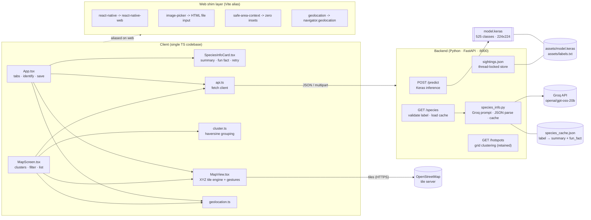
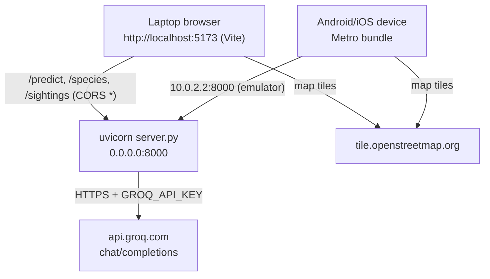
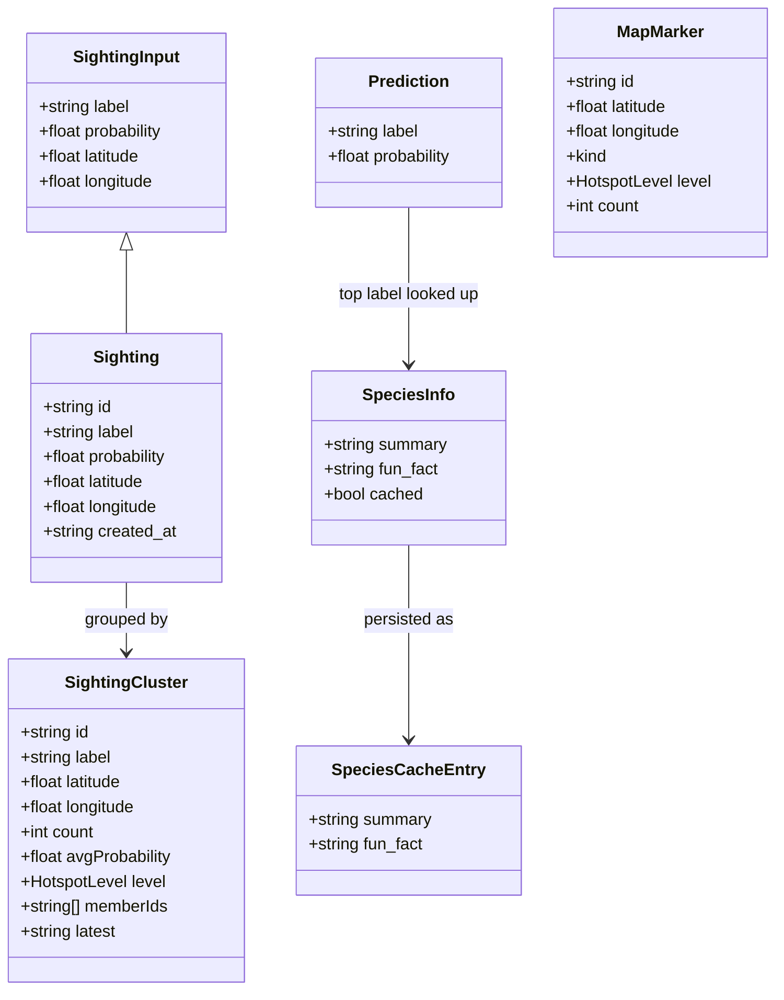
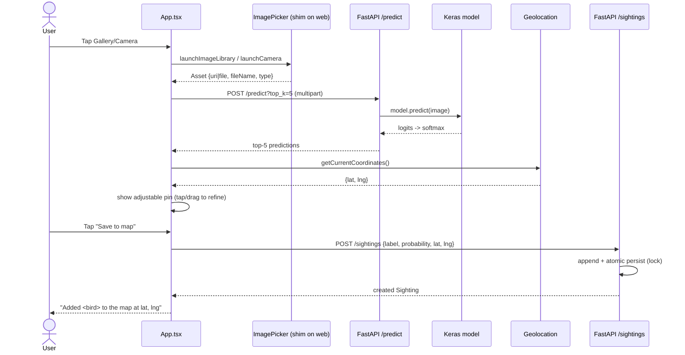
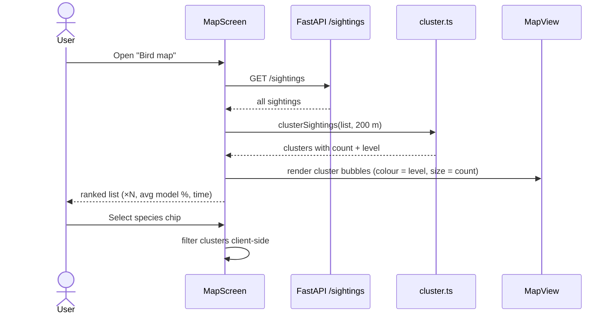
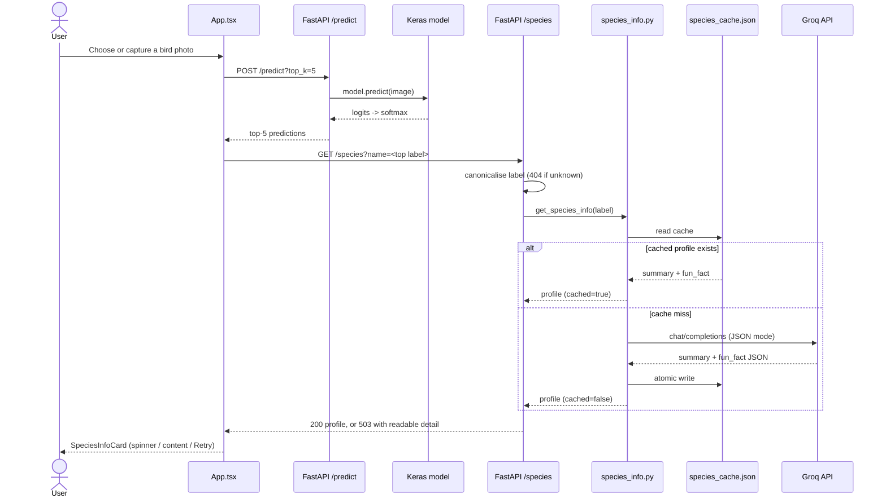
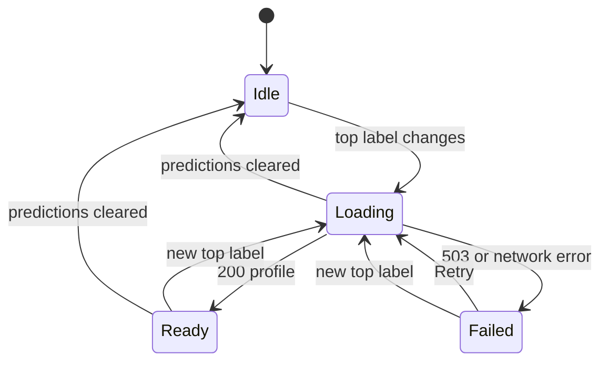
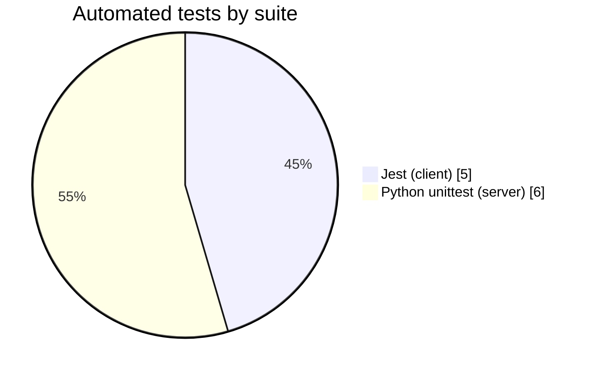
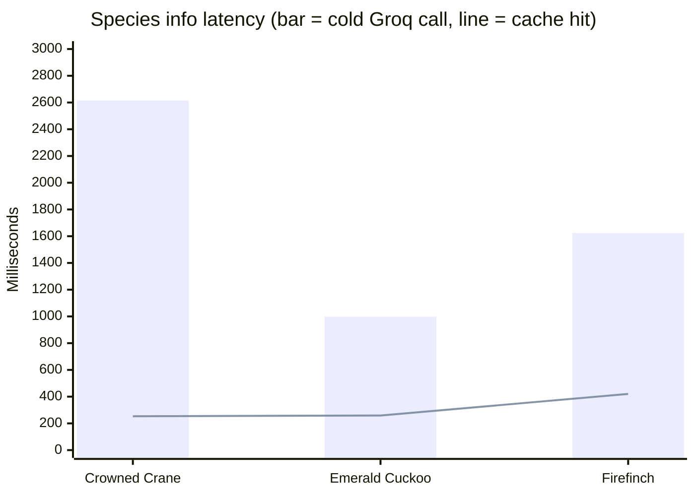

# BirdSpotter — Architecture & Technical Report

**Version:** 0.1.0
**Report date:** 2026-10-21
**Repository:** `dl_2/BirdSpotter` (React Native + Python backend)
**Status:** Working — identification, Groq-generated species info, geotagged sighting capture (web + native), and a proximity-clustered public bird map.

---

## 1. Executive summary

BirdSpotter is a bird identification and crowd-sourced mapping application. A user photographs a bird, a convolutional neural network (525 classes) identifies it with a confidence score, and the app adds a short **species info card** — an AI-written summary plus one fun fact — before the user pins the sighting on a map. Every sighting from every user is aggregated on a shared "Bird map", where each bird is rated **High / Medium / Low** based on **how often that species was spotted nearby** (within 200 m), not on the per-photo model score.

The product ships from **one TypeScript codebase** to two targets:

| Target | Runtime | Bundle | Entry |
|---|---|---|---|
| Android/iOS app | React Native 0.87 (Metro) | Hermes/native | `index.js` |
| Laptop web browser | React Native Web + Vite | ES modules | `web/main.tsx` |

A single **FastAPI** service hosts the ML model (Keras 3 on the PyTorch backend), the Groq-backed species info endpoint, and the sighting store (a JSON file guarded by a lock). The Groq API key is loaded from a server-side `.env` file and never reaches the client.

---

## 2. Purpose & feature set

1. **Identify** — pick a photo from the gallery or capture one with the camera; the model returns the top-5 species with probabilities.
2. **Save to map** — the confirmed species is pinned at the user's GPS location. The pin is **adjustable**: tap the map or drag the pin to fine-tune the exact spot.
3. **Species info** — once the top prediction is available, a card loads automatically with a 2–3 sentence summary and one fun fact generated by Groq's `openai/gpt-oss-20b` model. Successful profiles are cached per species, so repeat lookups make no API call.
4. **Bird map** — a global OpenStreetMap view of all sightings. Sightings of the same species within 200 m are merged into one **location cluster**, coloured and labelled by frequency:
   - **1 sighting → Low**
   - **2–3 sightings → Medium**
   - **4+ sightings → High**

Additional UX: species filter chips, a ranked list of clusters with average model confidence, zoom (buttons, mouse wheel, pinch), pan (drag), "Locate me", "Refresh", dark-mode aware theming, and responsive full-screen layout on wide screens.

---

## 3. Technology stack

### Client
| Area | Choice | Version |
|---|---|---|
| UI framework | React Native | 0.87.1 |
| React | React / React DOM | 19.2.3 |
| Web renderer | react-native-web | 0.21.4 |
| Web bundler | Vite (`@vitejs/plugin-react`) | 8.3.4 |
| Language | TypeScript | 6.0.3 |
| Image input | react-native-image-picker | 8.3.0 |
| Location | @react-native-community/geolocation | 3.4.0 |
| Safe areas | react-native-safe-area-context | 5.5.2 |
| Testing | Jest + react-test-renderer | 29.6.3 |
| Linting | ESLint (`@react-native/eslint-config`) | 8.x |

### Server
| Area | Choice | Version |
|---|---|---|
| Web framework | FastAPI | latest |
| ASGI server | uvicorn[standard] | latest |
| Validation | Pydantic (v2 API, `model_dump`) | via FastAPI |
| ML framework | Keras (PyTorch backend) | 3.5.0 |
| Tensor backend | torch (CPU) | 2.7.0+cpu |
| Imaging | Pillow | latest |
| Numerics | NumPy | latest |
| Storage | JSON file + `threading.Lock` | — |
| LLM provider | Groq Chat Completions API | `openai/gpt-oss-20b` |
| HTTP client (LLM) | Python standard library `urllib.request` | 3.13 |
| Env loading | python-dotenv | latest |

### External
- **OpenStreetMap raster tiles** — `https://tile.openstreetmap.org/{z}/{x}/{y}.png` (requires internet from the browser/device).
- **Groq API** — `https://api.groq.com/openai/v1/chat/completions`, called server-side only; requires `GROQ_API_KEY`.

---

## 4. System architecture

### 4.1 Logical view



### 4.2 ASCII fallback (same architecture)

```
        ┌─────────────────────────────────────────────────────────────┐
        │                    CLIENT (TypeScript)                       │
        │                                                             │
        │  App.tsx ──────────► MapView.tsx ◄────────── MapScreen.tsx   │
        │   (tabs,               (XYZ tiles,              (clusters,   │
        │    identify,            pan/zoom/pin)           filter,list) │
        │    save pin)                 ▲                        │      │
        │      │                       │                        ▼      │
        │      ▼                       │                   cluster.ts   │
        │  api.ts ──────────────┐      │                  (haversine)   │
        │  geolocation.ts       │      │                               │
        └───────────────────────┼──────┼───────────────────────────────┘
                                │      │
             (web only) Vite    │      │  HTTPS tiles
             aliases RN deps ───┘      ▼
                                │   ┌───────────────────────┐
                                ▼   │ tile.openstreetmap.org│
                    ┌───────────────────────────────────┐     │
                    │   BACKEND  FastAPI  :8000          │     │
                    │  /predict  /species  /sightings    │◄────┘
                    │  /hotspots /labels   /health       │
                    │      │        │                    │
                    │      ▼        ▼                    │
                    │  model.keras  species_info.py ─────┼──► Groq API
                    │  (torch)      species_cache.json   │    (gpt-oss-20b)
                    │  sightings.json                    │
                    └───────────────────────────────────┘
```

### 4.3 Deployment view



> The web app is served from `:5173` while the API runs on `:8000`; cross-origin access is enabled by `CORSMiddleware(allow_origins=["*"])`.

---

## 5. Repository layout

```
BirdSpotter/
├─ App.tsx                     # App shell: theming, tabs, identify + save-to-map flow
├─ index.js                    # Native entry (AppRegistry)
├─ app.json                    # App name/display name (shared by web entry)
├─ src/
│  ├─ api.ts                   # Typed fetch client + SERVER_URL per platform
│  ├─ cluster.ts               # Proximity clustering + count→level mapping
│  ├─ geolocation.ts           # Promise wrapper over native geolocation
│  ├─ MapView.tsx              # OSM XYZ tile engine, markers, pin, gestures
│  ├─ MapScreen.tsx            # Bird map: clusters, species filter, ranked list
│  └─ types.ts                 # Shared domain types
├─ web/                        # Web-only layer (Vite root)
│  ├─ index.html               # HTML host (#root, full-height CSS)
│  ├─ main.tsx                 # Web entry (AppRegistry.runApplication)
│  ├─ globals.d.ts             # Module + __DEV__ declarations
│  └─ shims/                   # Replacements for native-only modules
│     ├─ react-native.ts        # re-export RNW + PermissionsAndroid stub
│     ├─ image-picker.ts        # HTML <input type=file capture>
│     ├─ safe-area-context.tsx  # zero insets / no-op provider
│     └─ geolocation.ts         # navigator.geolocation adapter
├─ server.py                   # FastAPI: predict + species + sightings + hotspots
├─ species_info.py             # Groq prompt, JSON validation, per-species cache
├─ predict.py                  # CLI single-image classifier (dev tool)
├─ smoke_test.py               # Model load sanity check
├─ requirements.txt            # Python dependencies (incl. python-dotenv)
├─ .env                        # GROQ_API_KEY (git-ignored, never committed)
├─ sightings.json              # Persisted sightings (git-ignored)
├─ species_cache.json          # Cached Groq profiles (git-ignored)
├─ tests/
│  └─ test_species_info.py     # Python unittest suite (6 tests)
├─ docs/
│  └─ REPORT.md                # This document
├─ src/SpeciesInfoCard.tsx     # Info card UI (summary, fun fact, retry)
├─ vite.config.mjs             # Web build + RN→shim aliases
├─ tsconfig.json / tsconfig.web.json
├─ jest.config.js / jest.setup.js
├─ __tests__/                  # App + api + SpeciesInfoCard tests (5 tests)
├─ .eslintrc.js / .eslintignore / .prettierrc.js
├─ android/ · ios/             # Native hosts (permissions, launcher)
└─ README.md                   # Upstream RN getting-started (default)
```

---

## 6. Component reference

### 6.1 Application shell — `App.tsx`
- Wraps the tree in `SafeAreaProvider`; picks light/dark theme via `useColorScheme()`.
- Two tabs: **Identify** (`identify`) and **Bird map** (`map`).
- **Identify flow:** `classify()` builds a `FormData` (native = `{uri,name,type}`; web = real `File`/`Blob`) and `POST`s to `/predict?top_k=5`; renders top-5 as probability bars.
- **Save-to-map flow:** when predictions arrive, `locateForPin()` fetches GPS and seeds the adjustable pin + map centre (zoom 17). The user may **tap** or **drag** the pin. `saveSighting()` POSTs `{label, probability, latitude, longitude}` for the top prediction.
- **Species info flow:** when the top prediction changes, a `useEffect` calls `getSpeciesInfo(topLabel)` and renders `SpeciesInfoCard` with loading, success, and error/retry states. A cancellation flag prevents stale responses from overwriting a newer species.
- Responsive: `isWide = width ≥ 768` centres content at `maxWidth: 900`.

### 6.2 Map screen — `src/MapScreen.tsx`
- Loads all sightings (`getSightings()`), clusters them (`clusterSightings`), and computes a sensible centre/zoom (user GPS if present, else the sightings' centroid; zoom derived from coordinate spread).
- Renders species filter chips (derived from cluster labels), the `MapView`, zoom/locate/refresh controls, a legend, and a ranked list of clusters (`×N`, level badge, avg model %).
- Explains the confidence rule inline: *"1 = Low · 2–3 = Medium · 4+ = High, within 200 m"*.

### 6.3 Tile engine — `src/MapView.tsx`
A dependency-free slippy-map renderer usable on both platforms:
- **Projection:** Web Mercator. `worldX = (lng+180)/360 · 2^z · 256`; `worldY` via the inverse Gudermannian; inverse functions convert screen points back to lat/lng.
- **Tiles:** visible range `⌊left/256⌋ … ⌊(left+W)/256⌋` × Y-range; each tile is an absolutely-positioned `Image` at `(x·256−left, y·256−top)`.
- **Markers:** kinds `cluster` (count bubble coloured by level, radius scales with count), `hotspot`, `sighting`, `user`, `trailhead`; off-screen markers are culled.
- **Gestures (`PanResponder`):** drag-to-pan, two-finger pinch-to-zoom, single tap / drag of the pin (picker mode), plus a native `wheel` listener on web (attached to the RNW DOM node) for scroll-zoom. A `useWindowDimensions` fallback width prevents zero-size rendering.
- **Zoom bounds:** `MIN_ZOOM=3 … MAX_ZOOM=19`.

### 6.4 Clustering engine — `src/cluster.ts`
- `distanceMeters()` — haversine great-circle distance.
- `clusterSightings(sightings, tolerance = 200 m)` — single-pass greedy grouping: a sighting joins the nearest existing cluster **of the same label** whose running centroid is within tolerance, otherwise starts a new cluster. Returns per-cluster centroid, count, `avgProbability`, `memberIds`, `latest`.
- `levelFromCount()` — `≥4 → high`, `≥2 → medium`, else `low`.

### 6.5 API client — `src/api.ts`
- `SERVER_URL`: `http://10.0.2.2:8000` on Android (emulator loopback), else `http://localhost:8000`.
- Typed helpers: `getSpeciesInfo(name)`, `getSightings(label?)`, `getHotspots(label?)`, `addSighting(input)`, `deleteSighting(id)`; a `query()` helper omits empty params.
- Error handling: non-2xx responses surface FastAPI's `detail` message (e.g. `GROQ_API_KEY is not set on the server`) instead of a bare status code.

### 6.6 Geolocation — `src/geolocation.ts`
Promise wrapper around `getCurrentPosition` with `enableHighAccuracy`, 15 s timeout, 10 s max age. On web the import resolves to `web/shims/geolocation.ts` (`navigator.geolocation`, available only on `localhost`/HTTPS).

### 6.7 Web shim layer — `web/` + `vite.config.mjs`
Vite aliases native-only modules to browser equivalents so the RN code runs unchanged in a browser:

| Import (native) | Alias target | Behaviour |
|---|---|---|
| `react-native` | `web/shims/react-native.ts` | `export * from 'react-native-web'` + `PermissionsAndroid` stub |
| `react-native-image-picker` | `web/shims/image-picker.ts` | Hidden `<input type=file accept=image/* capture>`; returns `{uri,fileName,type,file}` |
| `react-native-safe-area-context` | `web/shims/safe-area-context.tsx` | Zero insets, `SafeAreaProvider` = `<Fragment>` |
| `@react-native-community/geolocation` | `web/shims/geolocation.ts` | `navigator.geolocation` adapter |

Also: `root = web/`, `outDir = web-dist/`, `define global=globalThis`, `__DEV__`, `dedupe` React, `.web.*` extension priority.

### 6.8 Backend — `server.py`
- **Startup:** loads `BirdSpotter/.env` via `python-dotenv`, then the Keras model, resolves labels (else `class i`), reads image size, and loads `sightings.json`.
- **Inference:** `POST /predict` reads bytes → PIL RGB → resize → softmax over logits → top-k (manual softmax for stability).
- **Species info:** `GET /species?name=...` canonicalises the label against the 525 known classes (404 if unknown) and delegates to `species_info.py`. `SpeciesInfoError` becomes HTTP 503 with a readable `detail`.
- **Store:** in-memory list mirrored to `sightings.json`; writes are atomic (`.tmp` + `os.replace`) under a `threading.Lock`.
- **Retained helper:** `GET /hotspots` performs grid (default cell `0.0009°`) clustering with **relative** scoring (`score = 100·count/max`, level at ≥66/≥33). The current UI computes confidence client-side via `cluster.ts`; the endpoint remains available/backwards-compatible.

### 6.9 Species info — `species_info.py` + `src/SpeciesInfoCard.tsx`
- **Input validation:** whitespace-normalised name; blank names rejected. Server accepts only labels present in `labels.txt` (case-insensitive).
- **Prompt:** asks for *only* a JSON object with `summary` (2–3 sentences covering habitat, diet, or behaviour) and `fun_fact` (one surprising sentence), plain text, no markdown.
- **Request:** Groq `chat/completions`, model `openai/gpt-oss-20b`, `temperature=0.4`, `response_format={"type":"json_object"}`, 20 s timeout. A custom `User-Agent: BirdSpotter/1.0` is sent because Groq's Cloudflare front-end blocks Python's default agent with HTTP 403.
- **Validation:** strips markdown code fences, parses JSON, rejects empty/missing fields.
- **Cache:** `species_cache.json` keyed by uppercased label. Cache hits avoid Groq entirely; writes are atomic. Profiles are shared across app restarts.
- **Errors:** missing key → 503 "GROQ_API_KEY is not set on the server"; HTTP errors include Groq's message; network/timeout → "Could not reach Groq". The client shows the message with a Retry button; identification is unaffected.
- **UI:** `SpeciesInfoCard` reuses the app theme, shows the species name, summary, and a highlighted fun-fact box, plus spinner/error states.

### 6.10 Model
- `assets/model.keras` (fallback `../Image_classify_Birds_Model.keras`); `assets/labels.txt` for class names.
- Input `224×224×3`, output 525 classes; softmax computed by hand from logits.

---

## 7. Data model



Persisted JSON (`sightings.json`) is an array of `Sighting` objects, e.g.:

```json
[
  {
    "label": "CROW",
    "probability": 1.0,
    "latitude": 21.195521168122106,
    "longitude": 79.07519428928872,
    "id": "ca11edd6355d4f5d85d093c46596d076",
    "created_at": "2026-10-15T08:14:29.372105+00:00"
  }
]
```

`species_cache.json` is an object keyed by uppercased species label (the server adds `cached` at read time):

```json
{
  "ABBOTTS BABBLER": {
    "summary": "The Abbotts Babbler is a small, insectivorous passerine ...",
    "fun_fact": "Despite its name, the Abbotts Babbler has a surprisingly complex ..."
  }
}
```

`git` ignores `sightings.json`, `species_cache.json`, `.env`, `web-dist/`, `node_modules/`, native build dirs and keystores.

---

## 8. API reference

| Method | Path | Query / Body | Returns |
|---|---|---|---|
| GET | `/health` | — | `{status, backend, classes, input, sightings}` |
| GET | `/labels` | — | `{labels: string[]}` |
| POST | `/predict` | multipart `file`; `?top_k=5` | `{predictions: [{label, probability}]}` |
| GET | `/species` | `?name=ABBOTTS%20BABBLER` | `{summary, fun_fact, cached}`; 404 unknown label, 503 Groq/key failure |
| POST | `/sightings` | JSON `SightingInput` | created `Sighting` |
| GET | `/sightings` | `?label=` | `{sightings: Sighting[]}` |
| DELETE | `/sightings/{id}` | — | `{removed: bool, sightings: int}` |
| GET | `/hotspots` | `?label=&cell=0.0009` | `{hotspots, center, max_count}` |

---

## 9. Runtime flows

### 9.1 Identify → save to map



### 9.2 View map → cluster → confidence



### 9.3 Identify → species info (AI card)



### 9.4 Species card UI states



---

## 10. Confidence scoring (two distinct notions)

| Where | Meaning | Source |
|---|---|---|
| **Identify tab** | Model confidence for the photo | Softmax probability from `/predict` (e.g. `88%`) |
| **Bird map** | Sighting frequency at a location | `clusterSightings` count → `levelFromCount` (Low/Medium/High), within 200 m |

```
level(count) = count >= 4 ? High
             : count >= 2 ? Medium
             :              Low
```

Tuning points: `RELATED_DISTANCE_METERS` (default `200`) and the thresholds in `levelFromCount()` (`src/cluster.ts`).

---

## 11. Platform matrix & build / run

| Concern | Native (Android/iOS) | Web |
|---|---|---|
| Entry | `index.js` → `AppRegistry` | `web/main.tsx` → `AppRegistry.runApplication` |
| Bundler | Metro | Vite |
| Image picker | `react-native-image-picker` | HTML file input shim |
| Geolocation | `@react-native-community/geolocation` | `navigator.geolocation` (localhost/HTTPS) |
| Safe areas | `react-native-safe-area-context` | zero-inset shim |
| API base | `10.0.2.2:8000` (Android) | `localhost:8000` |
| Layout | phone-sized | full-screen, centred `maxWidth 900` |

**Run the backend**
```powershell
.\.venv\Scripts\python.exe server.py        # 0.0.0.0:8000
```

**Run the web client**
```powershell
npm run web                                  # http://localhost:5173
```

**Run native**
```powershell
npm start            # Metro
npm run android      # or: npm run ios
```

---

## 12. Configuration & constants

| Constant | Location | Value | Purpose |
|---|---|---|---|
| `SERVER_URL` | `src/api.ts` | android `10.0.2.2:8000`, else `localhost:8000` | API host per platform |
| `MIN_ZOOM` / `MAX_ZOOM` | `src/MapView.tsx` | 3 / 19 | Tile zoom bounds |
| `TILE` | `src/MapView.tsx` | 256 | Tile pixel size |
| `RELATED_DISTANCE_METERS` | `src/cluster.ts` | 200 | Cluster radius |
| level thresholds | `src/cluster.ts` | 2 / 4 | Medium / High cut-offs |
| hotspot `cell` | `server.py` | 0.0009° | Server grid (retained endpoint) |
| `DATA_FILE` | `server.py` | `sightings.json` | Persistence |
| `GROQ_MODEL` | `species_info.py` | `openai/gpt-oss-20b` | LLM used for species profiles |
| `GROQ_API_KEY` | `.env` (server only) | secret | Groq authentication |
| `CACHE_FILE` | `species_info.py` | `species_cache.json` | Per-species profile cache |
| Groq timeout / temperature | `species_info.py` | 20 s / 0.4 | Request bounds and variation |

Android permissions (`android/app/src/main/AndroidManifest.xml`): `INTERNET`, `CAMERA`, `ACCESS_FINE_LOCATION`, `ACCESS_COARSE_LOCATION`.

---

## 13. Build, test & quality gates

| Command | Purpose |
|---|---|
| `npm run typecheck` | TS check (native config) |
| `npm run typecheck:web` | TS check (DOM libs, web config) |
| `npm run lint` | ESLint |
| `npm test` | Jest (App smoke render, API client, SpeciesInfoCard) |
| `npm run web:build` | Production web bundle → `web-dist/` |
| `python -m unittest discover -s tests` | Species info unit tests (6) |
| `python smoke_test.py` | Model loads and exposes shapes |
| `python predict.py  -k 5` | CLI classification sanity check |

`jest.setup.js` mocks geolocation so the smoke test runs headless. `tsconfig.json` excludes `web/`, `web-dist/`, `vite.config.mjs`; `tsconfig.web.json` adds `DOM` libs for the browser layer.

### 13.1 Automated test composition



Latest run: **Jest 5/5**, **Python 6/6**, both TypeScript projects typecheck, ESLint reports 0 errors (5 pre-existing inline-style warnings), and the Vite production build succeeds.

---

## 14. Security & privacy

- **No authentication** — the API is open; `CORS` allows all origins. Intended for local/LAN use.
- **Location is precise** — sightings store exact coordinates, visible to everyone. The clustering only *groups* them (200 m) for display; individual records remain exact.
- **Secrets stay server-side** — `GROQ_API_KEY` is read from `.env`, which is git-ignored and never bundled into the web/native client. The key is not logged; HTTP errors include Groq's message, not the credential.
- **Third-party data flow** — only the species *label* is sent to Groq; photos, coordinates, and user identity are never sent. Generated text is treated as display content and profile fields are validated before storage.
- **Prompt-surface** — the server rejects labels outside the 525-class list, so users cannot inject arbitrary prompts through `/species`.
- **Transport** is HTTP (cleartext) in dev; Android enables cleartext via the `usesCleartextTraffic` manifest placeholder. The Groq hop is HTTPS.
- **Inference** runs server-side on CPU; no images persist (only label + coordinates are stored). `species_cache.json` stores generated text only.
- **No rate limiting** — an open `/species` endpoint can consume Groq quota; add auth/limits before public deployment.

---

## 15. Known limitations & future work

**Limitations**
- Sightings are stored in a single JSON file with a process lock — not multi-process safe and not durable for scale.
- Species profiles depend on a live Groq call on first lookup; without a key or internet the card shows an error and Retry (identification still works).
- LLM output is probabilistic — summaries/facts are plausible but not fact-checked; the model can hallucinate.
- Cache entries never expire. A profile generated once is reused forever unless `species_cache.json` is edited or deleted.
- Cache hits still re-read the JSON file on every request (~250–420 ms in the measured OneDrive-backed workspace), and concurrent processes can overwrite each other's cache writes.
- Groq availability, rate limits, and model deprecations are external risks (see §16.4).
- OpenStreetMap tile usage is fine for light/dev traffic; production should use a proper tile provider per its usage policy.
- Browser geolocation requires `localhost`/HTTPS; a LAN IP will block it.
- `GET /hotspots` still implements the older **relative** scoring and is unused by the current UI (client-side clustering is authoritative).
- `getHotspots()` in `src/api.ts` is currently unused by the UI.

**Suggested next steps**
- Swap the JSON store for SQLite/Postgres with a unique index and migrations.
- Add a `/clusters` (or extend `/hotspots`) server-side endpoint so clustering is authoritative and shared, not recomputed per client.
- Move the species cache into an in-memory dict (loaded once at startup) with a TTL/refresh endpoint, and add a "Regenerate" action.
- Add auth, per-user attribution, and rate limiting on `/species` to protect the Groq quota.
- Validate AI text more strictly (length limits, banned-content checks) or use Groq structured outputs with a JSON schema.
- Bundle a small offline fallback set of profiles for the most common species.
- Debounce/duplicate-suppress rapid repeat taps.
- Replace raster tiles with a vector/cached provider; consider offline caching.
- Add integration tests for `cluster.ts` (distance + threshold boundaries) and the API.
- Reverse-geocode clusters to human-readable place names.

---

## 16. Species info feature — implementation record

### 16.1 Objective

After the classifier returns a species, automatically show a compact **species info card** containing only:

1. the species name (already supplied by the model), and
2. an AI-generated **summary** plus **one fun fact**.

The Groq API key must remain server-side, repeat lookups must be cheap, and identification must still work if the LLM is unavailable.

### 16.2 Files changed

| Area | File | Change |
|---|---|---|
| Backend | `species_info.py` | **New.** Groq request, JSON parsing/validation, disk cache, error types |
| Backend | `server.py` | Loads `.env`; label lookup table; new `GET /species`; 404/503 mapping |
| Client | `src/SpeciesInfoCard.tsx` | **New.** Loading, success, error + Retry card |
| Client | `src/api.ts` | `getSpeciesInfo()`; non-2xx `detail` surfaced in errors |
| Client | `src/types.ts` | `SpeciesInfo` type |
| Client | `App.tsx` | Auto-fetch on top label change, stale-response guard, card placement |
| Config | `requirements.txt` | Added `python-dotenv` |
| Config | `.gitignore` | Ignore `.env` and `species_cache.json` |
| Tests | `tests/test_species_info.py` | **New.** 6 Python unit tests |
| Tests | `__tests__/api.test.ts` | **New.** 2 client API tests |
| Tests | `__tests__/SpeciesInfoCard.test.tsx` | **New.** 2 component tests |
| Docs | `docs/REPORT.md` | This updated report |

No new client dependency was introduced. The Groq call uses the Python standard library (`urllib.request`), so the runtime footprint is unchanged apart from `python-dotenv`.

### 16.3 API contract

```http
GET /species?name=ABBOTTS%20BABBLER
```

```json
{
  "summary": "2–3 sentence profile covering habitat, diet, or behaviour.",
  "fun_fact": "One surprising, memorable sentence.",
  "cached": false
}
```

| Condition | Status | Body |
|---|---|---|
| Label not in the 525 classes | `404` | `{"detail": "Unknown species label"}` |
| Key missing | `503` | `{"detail": "GROQ_API_KEY is not set on the server"}` |
| Groq HTTP/network failure | `503` | `{"detail": "Groq request failed with status N: ..."}` |
| Cache hit | `200` | profile with `"cached": true` |
| Fresh generation | `200` | profile with `"cached": false` and cache written |

The server normalises case and whitespace, so `abbotts babbler`, `ABBOTTS BABBLER`, and `Abbotts Babbler` share one cache entry.

### 16.4 Problems found and fixes applied

| Problem | Symptom | Fix |
|---|---|---|
| `.env` was ignored | `GROQ_API_KEY is not set on the server` even with a key in `.env` | Load `BirdSpotter/.env` with `python-dotenv` at startup |
| Cloudflare blocked the request | HTTP `403`, body `error code: 1010` | Send `User-Agent: BirdSpotter/1.0` (Python's default agent was rejected) |
| Configured model retired | HTTP `404`, `model_not_found` for `llama-3.3-70b-versatile` | Queried `/openai/v1/models`; switched to `openai/gpt-oss-20b` |
| Errors lacked context in the app | UI showed only `Server responded 503` | API client parses FastAPI's `detail` field |
| Retry was untestable | `Pressable` not discoverable in `react-test-renderer` | Added `testID="species-retry"` and asserted on it |
| TypeScript test typing | `Cannot find name 'global'` | Use `globalThis.fetch` |

### 16.5 Measured latency

Three uncached labels were requested live through Groq on 2026-10-21, then immediately requested again to measure the cache path. Times are wall-clock milliseconds measured in a local Python process that imported `species_info` directly (no model inference included), on Windows 11 with the repo in a OneDrive-backed folder. Cold includes network latency, generation, validation, and cache write; cached includes reading/parsing the cache file.

| Species | Cold (Groq) | Cached |
|---|---:|---:|
| AFRICAN CROWNED CRANE | 2,615 ms | 253 ms |
| AFRICAN EMERALD CUCKOO | 998 ms | 259 ms |
| AFRICAN FIREFINCH | 1,624 ms | 420 ms |
| **Mean** | **1,746 ms** | **311 ms** |



Cache reuse avoids the external call and cuts mean latency by roughly **5.6×** in this environment. The remaining cache-hit cost is dominated by re-reading the OneDrive-backed JSON file on every request; an in-memory cache is the obvious next optimisation.

### 16.6 Verification evidence

| Check | Result |
|---|---|
| `npm test` | 3 suites, **5/5 tests passed** |
| `python -m unittest discover -s tests` | **6/6 tests passed** |
| `npm run typecheck` | passed |
| `npm run typecheck:web` | passed |
| `npm run lint` | 0 errors (5 pre-existing inline-style warnings) |
| `npm run web:build` | Vite production build succeeded |
| Live Groq generation | `ABBOTTS BABBLER` returned a profile with `cached: false` |
| Cache hit | second request returned `cached: true` |
| Missing key | endpoint returned `503 GROQ_API_KEY is not set on the server` |
| Unknown label | endpoint returned `404 Unknown species label` |
| Server import | model loaded, 525 classes, `/species` route registered |

### 16.7 Design decisions

| Decision | Reason |
|---|---|
| Key on the server, not the app | A bundled key is extractable from web/native bundles; the backend already exists |
| Persistent JSON cache | Zero new infrastructure, survives restarts, and matches the existing `sightings.json` pattern |
| Strict label allow-list | Prevents arbitrary prompts/abuse and ties every profile to a real model class |
| 2–3 sentence summary + one fact | Matches the requested scope; keeps tokens, latency, and UI size small |
| Graceful degradation | A failed LLM call must never block identification or map saving |
| Standard-library HTTP | Avoids adding a Groq SDK; the request is a single JSON POST |

---

*Generated as a point-in-time architecture report. File/line references reflect the repository at the date above.*
